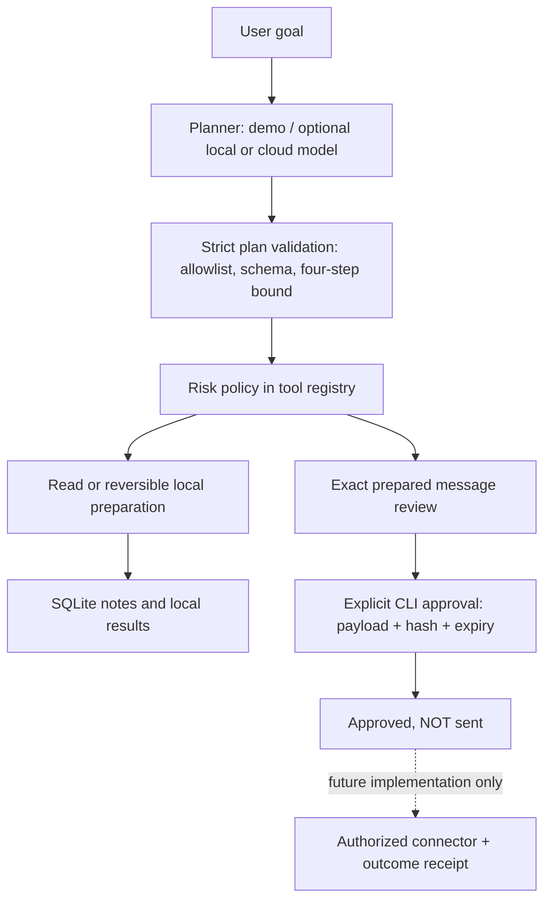

# How the agent works

## Brain

`agent/providers.py` is the planner interface. The default brain is deterministic and
understands `calculate`, `remember`, `find`, `time`, `draft RECIPIENT: TEXT` and
`goal: STEP; STEP` (maximum four). Optional language-model adapters propose the same JSON
schema. Model output is untrusted; validation precedes **any** tool in the entire plan.
No model-supplied approval, unknown argument, unknown tool, code or dynamic import is
accepted. The application never evaluates Python from a model.

`agent/core.py` owns the bounded execution loop, not the model. Safe read/preparation
steps run without permission prompts. A failure stops subsequent steps; earlier completed
steps are not rolled back. The result distinguishes completed, failed and pending work.
The top-level `processed` means the loop processed a plan, not that every goal succeeded.

Plans are fixed for one run. There is no model feedback loop, recursive sub-agent,
background job or result interpolation between steps. Tool outputs remain data. A later
request can search notes and use the results explicitly. Broad research and arbitrary
natural-language goal completion remain roadmap items.

## Memory

`agent/memory.py` stores notes, prepared reviews and audit rows in local SQLite. Notes are
simple case-insensitive substring search, with at most 20 matches. Note creation is
requested reversible local preparation, so it does not require repeated approvals.
There is no automatic extraction of personal facts, no embedding index and no cloud sync.
Database contents are plaintext. The optional cloud planner never receives database
contents; it receives only the current user request and static policy prompt.

## Risk and permissions

| Class | Current examples | Runtime behavior |
|---|---|---|
| Read | Calculator, UTC clock, local note search | Run after plan validation |
| Local reversible preparation | Save a requested local note | Run; return local result |
| Consequential external action | Message draft | Prepare exact recipient/body and stop for review |
| Unimplemented/disallowed | Sending, payments, deletion, access changes, arbitrary shell | No handler; unknown tool rejected |

The only implemented review artifact is a demo message. `approve` loads the saved payload,
validates it again, checks its hash and expiry, then marks it `approved_not_sent` in a
single SQLite transaction. No model is called, no provider is contacted, and no dispatch
occurs. A duplicate approval fails. `revise` atomically marks the old artifact superseded
and creates a new unapproved artifact, including when the previous one was approved.
Hashes detect accidental payload changes, not a malicious local user who can edit both
the database and application. See SECURITY.md.

## From starter to real personal agent

The intended larger flow is goal -> bounded planning/research -> authorized read tools ->
independent reversible preparation -> exact-action review -> execution -> verified receipt.
Missing essentials should be asked early; harmless preparation should not trigger repeat
permission questions. This starter rejects incomplete arguments or unsupported requests
instead of guessing. It does not yet offer conversational clarification or a research
engine. Implement those with explicit source boundaries and budgets, not fictitious tools.

Future plans must record: authorized account, destination, complete content, cost/limits,
expiry, exact version, and idempotency key. After an uncertain external write, reconcile
its outcome before retrying. An approval is not a success receipt. Final consequential
work must stay disabled until these controls are actually implemented and tested.
